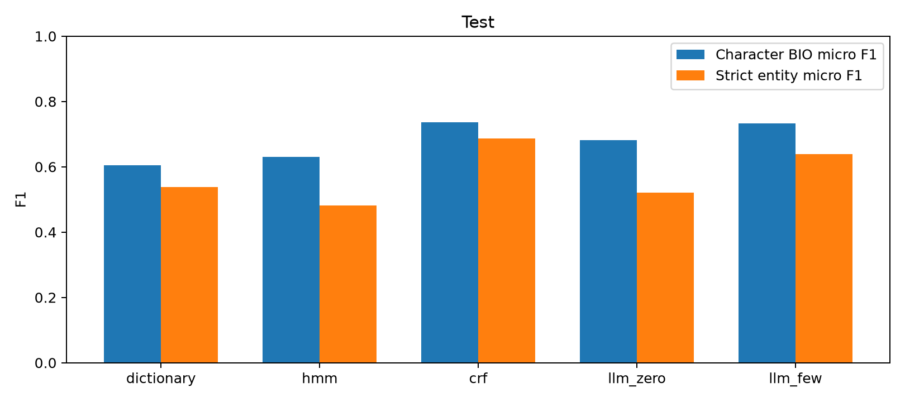

# CLUENER2020 实验结果（自动生成实测部分）

评估集合：**Test**。本报告仅包含已保存预测的实测结果。人工核验、成员贡献声明与录屏仍须本人完成。

## 数据与评估协议

系统随机种子 `718853259` 只生成一次。Train/Dev/Test=9539/1343/1209；有效训练9538。唯一嵌套样本train:1506固定在Train并统一跳过。官方Dev逐字节保留；原Train完整分配。源数据许可仍待确认，仓库不发布语料。

字符级指标对20个非O BIO标签做micro统计，O→O不增加TP；严格实体指标要求起点、终点、类别同时一致。主指标使用统一BIO规范化。非法I转换、重复输出、重叠投影、无效输出及失败率见每组metrics.json。含O的accuracy只作辅助。

## 主结果

| 方法 | Token P | Token R | Token F1 | 实体 P | 实体 R | 实体 F1 |
|---|---:|---:|---:|---:|---:|---:|
| dictionary | 70.44% | 52.88% | 60.41% | 51.43% | 56.38% | 53.79% |
| hmm | 60.85% | 65.22% | 62.96% | 47.47% | 48.79% | 48.12% |
| crf | 76.77% | 70.89% | 73.71% | 73.14% | 64.69% | 68.66% |
| llm_zero | 72.92% | 63.91% | 68.12% | 52.39% | 51.66% | 52.03% |
| llm_few | 78.02% | 69.19% | 73.34% | 66.98% | 61.14% | 63.93% |

Token F1排序：crf > llm_few > llm_zero > hmm > dictionary。实体F1排序：crf > llm_few > dictionary > llm_zero > hmm。排名差异说明局部字符正确不等于完整实体正确，评估口径会影响方案判断。

## 原理实验：词表、序列约束与指标

HMM只使用Train字符计数构建词表，小于阈值的字符统一映射UNK；9组参数均在Dev选参。下表同一组概率参数仅切换Viterbi合法BIO约束，因此可单独观察解码约束的作用。非法率分母为全部字符位置，评分前统一修复非法I。

| alpha | 最低频次 | 词表大小 | Dev未登录字符率 | 无约束实体F1 | 约束实体F1 | 无约束非法率 |
|---:|---:|---:|---:|---:|---:|---:|
| 0.01 | 1 | 3593 | 0.1811% | 0.4829 | 0.4829 | 0.0000% |
| 0.01 | 2 | 3019 | 0.3741% | 0.4845 | 0.4845 | 0.0000% |
| 0.01 | 3 | 2732 | 0.5690% | 0.4842 | 0.4842 | 0.0000% |
| 0.1 | 1 | 3593 | 0.1811% | 0.4769 | 0.4769 | 0.0000% |
| 0.1 | 2 | 3019 | 0.3741% | 0.4774 | 0.4774 | 0.0000% |
| 0.1 | 3 | 2732 | 0.5690% | 0.4749 | 0.4749 | 0.0000% |
| 1.0 | 1 | 3593 | 0.1811% | 0.4429 | 0.4429 | 0.0020% |
| 1.0 | 2 | 3019 | 0.3741% | 0.4481 | 0.4481 | 0.0020% |
| 1.0 | 3 | 2732 | 0.5690% | 0.4488 | 0.4488 | 0.0020% |

词表证据：固定alpha=0.01，阈值1→3使词表从3593缩至2732，Dev未登录字符率从0.181%升至0.569%；F1并不随词表增大单调改善，阈值2在这组中最高。说明UNK汇聚与字符稀疏性之间存在取舍，本实验不能推广为阈值2对其他语料也最优。

约束证据：9组中约束/无约束规范化后实体F1最大绝对差为0.000000。本次约束没有带来可见F1提升；无约束非法转移本来极少，且统一I→B修复会消除部分差异。不能据此声称约束提高了准确率，也不能推出标签约束没有作用。

选择规则为Dev严格实体micro F1最大；同分依次比较训练加预测耗时、配置顺序。未按Test调整参数。完整CRF/HMM参数与耗时见tables/baseline_parameters.csv。

Token只要求单个字符BIO标签正确，一个实体边界错一位仍可能保留很多正确字符，但严格实体会同时增加一个FP和一个FN。下面实际案例同时展示两种分数；不能以accuracy替代Token P/R/F1。

## 真实错误案例与局限

以下归因为自动的一对一跨度匹配结果，尚未经两名成员人工核验。先移除完全匹配实体，再最大权重一对一匹配：同边界优先，同类重叠其次，其他重叠再次；余下分别为漏抽、误抽。边界与类型同时错误独列，避免重复计数。

### 案例1：llm_few / train:2727 / boundary

环球时报特约记者宋华报道，据俄新社报道，美国驻格鲁吉亚大使馆7月13日宣布，美国海军“阿利伯克”级“

真实跨度：`[4, 8, "position"]`；预测跨度：`[6, 8, "position"]`。该句Token F1=0.708，实体F1=0.545。

### 案例2：hmm / train:8937 / boundary_and_type

当初创办信托机构的意图是为了保护盖蒂家族的后代不论金融和经济状况如何都能生活无虑，

真实跨度：`[16, 18, "name"]`；预测跨度：`[16, 19, "scene"]`。该句Token F1=0.000，实体F1=0.000。

### 案例3：dictionary / train:4826 / missed

人民网2月17日电《火爆狂飙：天堂》有着精美的画面，超高的自由度，

真实跨度：`[0, 3, "company"]`；预测跨度：`null`。该句Token F1=0.857，实体F1=0.667。

### 案例4：dictionary / train:9297 / spurious

与前几季两队在英冠中交锋时全部在2.00以下的主胜赔率相比，博彩公司也算对赫尔城刮目相看。

真实跨度：`null`；预测跨度：`[9, 10, "company"]`。该句Token F1=0.900，实体F1=0.750。

### 案例5：llm_few / train:9046 / type

如果不是自驾前往，那么目前从成都到青城山主要有以下4种方式班车、城际动车、景区直通车和跟团包车。

真实跨度：`[17, 20, "address"]`；预测跨度：`[17, 20, "scene"]`。该句Token F1=0.400，实体F1=0.500。

### 案例6：llm_zero / train:10622 / boundary

田申申：在历史上1851年第一届世博会在伦敦，出现的是伦敦的水晶宫，当时体现了工业化的审美，

真实跨度：`[27, 33, "address"]`；预测跨度：`[27, 29, "address"]`。该句Token F1=0.583，实体F1=0.500。

## 少样本数量实验

固定300条Dev子集；表中是调参结果，不是Test。

| 示例数 | Token F1 | 实体 F1 |
|---:|---:|---:|
| 0 | 0.6699 | 0.5201 |
| 2 | 0.6745 | 0.5670 |
| 4 | 0.7135 | 0.6475 |
| 8 | 0.7088 | 0.6288 |

按预定规则选择4个示例。4-shot优于8-shot，说明这组固定示例中增加示例并不保证提升；不能区分示例内容与数量的全部影响，未验证LoRA或微调。

局限：词典缺少未见名称且存在同名歧义；HMM只使用一阶状态和字符发射，较难利用长上下文；CRF依赖局部特征；LLM可能与数据集类别边界约定不同。例如提示要求排除书名号，而语料部分游戏名包含书名号，这可能造成边界错误；本轮Test后不再修提示，应留作下一轮预注册对照。具体占比见error_counts.csv；这些解释需结合人工核验，不能将标注差异一概归为模型错误。

## 成本、延迟与不确定性

累计请求尝试5704次；输入7451146、输出219538 tokens。按官网低/高峰价格估算累计费用范围为3.2121–6.4242元；高峰价格控制100元预算，真实账单以账户为准。未知计费失败保守预留0.0000元。缓存重放不产生新调用。

单价来源：[DeepSeek官方价格](https://api-docs.deepseek.com/zh-cn/quick_start/pricing/)，核对日期2026-10-23。deepseek-flash高峰价每百万token：缓存命中输入0.04元、未命中输入2元、输出8元；空闲时段分别为0.02、1、4元。预算使用高峰价，不将区间估算冒充精确账单。

延迟为每句请求/推断耗时，LLM含必要重试；缓存样本沿用首次真实调用耗时，不将读缓存耗时混入。见tables/latency.csv。8线程只是API吞吐设置，单句延迟与本地CPU模型不可直接解释为计算效率。

llm_zero − crf：实体F1差值-0.1663，2000次句子级配对bootstrap 95%百分位区间[-0.1915841535916601, -0.1413157717519044]；seed=718853259。该区间不覆盖训练随机性、API版本变化或人工标注不确定性。
llm_few − crf：实体F1差值-0.0473，2000次句子级配对bootstrap 95%百分位区间[-0.07186563035585676, -0.023087066391177923]；seed=718853259。该区间不覆盖训练随机性、API版本变化或人工标注不确定性。

## 复现与待完成的人工工作

运行 `python scripts/replay.py` 可离线重算全部已保存预测，要求指标与原文件完全一致。实际代码、数据/模型哈希、冻结配置及API原始响应均保存在本地结果包中。

两名成员各自填写review/independent_A_20_test.csv、independent_B_20_test.csv，再共同复核40条；不要把自动归因当成人工确认。至少核验报告的6个案例并写出具体原因。贡献声明、AI使用声明与真实演示录屏由成员补充。

AI辅助完成了代码实现、自动运行、图表与报告草稿；没有替代两人的独立人工判断。大模型零/少样本实验不支持有关未实施LoRA或微调的结论。
